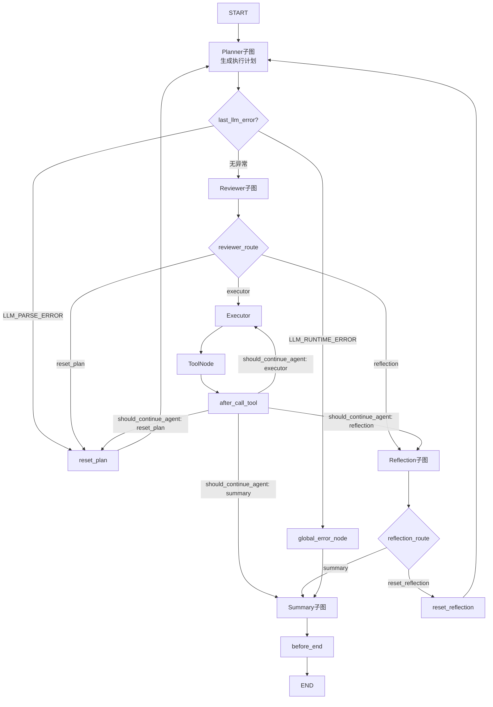

# 多Agent闭环工具系统

基于 LangGraph 搭建多子Agent协同工具调用Agent，面向本地文件、脚本执行场景。具备安全审批、结果自检、失败重规划熔断能力，支持命令行配置与 PyInstaller 单机打包交付。

## 项目亮点

-  **多Agent子图协作架构**：路由Agent负责意图分发，拆分为 Planner / Reviewer / Executor / Reflection 独立子Agent，共享统一状态上下文，依靠条件边动态流转
- **人工安全审批**：Reviewer 节点拦截高危文件、脚本操作，对标 Cursor 写入确认机制，风险计划需要人工确认后才允许执行
-  **Reflection 反思自检**：不仅捕获程序异常，还可以识别「工具返回执行成功，但业务结果不符合需求」的隐性故障；配置最大重试次数，到达上限自动熔断，避免无限循环重规划
-  **全链路异常兜底**：双策略 JSON 解析（标准解析 + ast.literal_eval 降级兼容），独立 error 异常分支，保障图链路稳定
-  **CLI 命令行配置工具**：无需修改源码，终端动态管理 LLM 参数，配置持久化写入 `.env`
-  **单机交付方案**：支持 PyInstaller 打包为独立可执行程序，目标机器无需预装 Python 环境

##  整体流程图



## 环境安装

```shell
pip install -r requirements.txt
```

## CLI 配置命令（自动持久化到 .env）

```shell
# 查看版本
python main.py --version

# 设置 LLM 配置
python main.py --set_key sk-xxxx
python main.py --set_url https://xxx/v1
python main.py --set_model qwen3-8b

# 查看当前配置
python main.py --show_key
python main.py --show_url
python main.py --show_model

# 删除配置项
python main.py --rm_key
python main.py --rm_url
python main.py --rm_model
```

## 启动运行

```shell
python main.py
```

## PyInstaller 打包

```shell
pyinstaller --onefile --console script.py
```

## 技术栈

Python、LangGraph、LangChain、Pydantic、argparse、python-dotenv、SQLite
